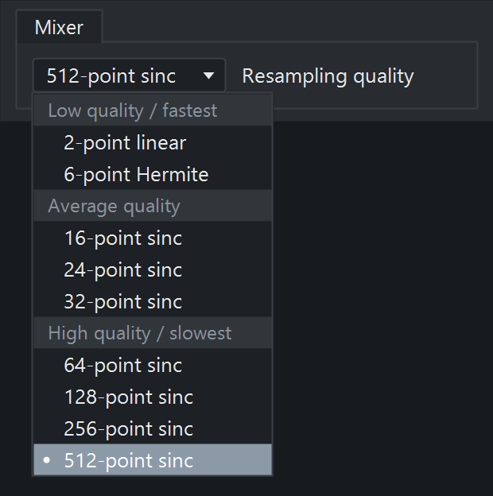

<div align="center">

# 🎛️ FL Mixer - Papielguapo

**Clon 1:1 Bit-Exact del motor de Resampling Quality del Mixer de FL Studio (`FLEngine_x64.dll` / `TResampler`) en formato VST3 (64-bit) para Windows, creado por [papielguapo](https://github.com/papielguapo).**


---

### 🖼️ Vista del Plugin (`310 × 76 px`)


### 📋 Menú Desplegable con los 9 Modos Originales de `TResampler`



</div>

---

## 📖 Descripción

**FL Mixer - Papielguapo** reproduce de forma **1:1 bit-exact** la sección **Mixer — Resampling quality** de las opciones de audio de **FL Studio** (`Audio Settings -> Mixer -> Resampling quality`), permitiendo insertar el carácter exacto de los algoritmos de interpolación y diezmado de `FLEngine_x64.dll` en cualquier pista o bus de cualquier DAW compatible con **VST3**.

El procesador ejecuta un ciclo racional de remuestreo de ida y vuelta (**Downsampling `8 → 7` seguido de Upsampling `7 → 8`**) utilizando las rutinas y constantes IEEE-754 exactas extraídas de `FLEngine_x64.dll`:

- **Interfaz idéntica al panel de FL Studio:** Pestaña `Mixer`, marco `#393F45`, fondo `#282C30`, selector desplegable `#1D2024` con encabezados de sección no seleccionables (`Low quality / fastest`, `Average quality`, `High quality / slowest`) y tipografía `Segoe UI`.
- **Conmutación en vivo libre de clics (Click-Free Live Switching):** Ambas etapas del pipeline están cebadas con el lookahead máximo (`halfTaps = 256`), manteniendo una **latencia entera constante de `553 muestras`** en los 9 modos y reportándola automáticamente al DAW para compensación de retardo (PDC) exacta.

---

## 🧠 Arquitectura del Motor DSP (`FLEngine_x64.dll` 1:1)

El motor de audio (`Source/PluginProcessor.cpp`) implementa los **3 núcleos matemáticos nativos** de `TResampler` en `FLEngine_x64.dll`:

### 1. `2-point linear` (`VA 0x0067A940`)
Interpolación lineal en doble precisión (`double`) entre muestras adyacentes antes del redondeo final a `float` de 32 bits (`cvtss2sd` → `mulsd` → `addsd` → `cvtsd2ss`):
```cpp
y = static_cast<float>(y0 * (1.0 - frac) + y1 * frac);
```

### 2. `6-point Hermite` (`VA 0x0067B220` + tabla `.rdata` `VA 0x013E9EB4..0x013E9EF8`)
Polinomio de Hermite de 5.º orden evaluado mediante el esquema de Horner centrado en `t = frac - 0.5`, combinando pares simétricos (`ym2 + y3`, `ym1 + y2`, `y0 + y1`) y antisimétricos (`ym2 - y3`, `ym1 - y2`, `y0 - y1`) con las **18 constantes flotantes IEEE-754 exactas** (`bitCastFloat`) del binario original.

### 3. `16 / 24 / 32 / 64 / 128 / 256 / 512-point sinc` (`VA 0x0067C510`, `0x0067C600`, `0x0067D320`, `0x0067D9B0`)
Núcleo Sinc enventanado con **recurrencia de Chebyshev de dos pasos** y evaluación **SSE intrínseca (`_mm_rcp_ps` + refinamiento Newton-Raphson de 1 paso)**:
- **Tabla `halfTaps` (`VA 0x013EB80C`):** `{ 1, 3, 8, 12, 16, 32, 64, 128, 256 }` correspondiente a `{ 2, 6, 16, 24, 32, 64, 128, 256, 512 }` puntos.
- **Umbral mínimo de fase (`ippsThreshold_LT_64f_I` @ `VA 0x0067CA78`):** `1.0e-25` (`0x3ABEF2D0F5DA7DD9`).
- **Ventana polinómica par de FL Studio (`VA 0x0067C9EC..0x0067CA50`):**
  $$w(u) = 0.5 \cdot (0.64 \cdot u^2 + u + 0.36), \quad u = \cos(\Delta_W \cdot x)$$
- **Filtro antialiasing adaptativo por etapa:**
  - **Etapa 1 (`8 → 7`, `step = 8/7 > 1.0`):** $\Delta_S = \pi / (8/7)$ (corte band-limited para diezmado).
  - **Etapa 2 (`7 → 8`, `step = 7/8 <= 1.0`):** $\Delta_S = \pi$, $2\cos(\Delta_S) = -2.0$.

---

## 🎚️ Los 9 Modos de Calidad

| Categoría en el Menú | Modo | `halfTaps` | Taps Totales | Algoritmo (`FLEngine_x64.dll`) |
| :--- | :--- | :---: | :---: | :--- |
| **Low quality / fastest** | `2-point linear` | `1` | `2` | Interpolación lineal `double` (`VA 0x0067A940`) |
| **Low quality / fastest** | `6-point Hermite` | `3` | `6` | Hermite 5.º orden simétrico/antisimétrico (`VA 0x0067B220`) |
| **Average quality** | `16-point sinc` | `8` | `16` | Sinc Chebyshev + SSE `_mm_rcp_ps` NR (`VA 0x0067C600`) |
| **Average quality** | `24-point sinc` | `12` | `24` | Sinc Chebyshev + SSE `_mm_rcp_ps` NR (`VA 0x0067C600`) |
| **Average quality** | `32-point sinc` | `16` | `32` | Sinc Chebyshev + SSE `_mm_rcp_ps` NR (`VA 0x0067C600`) |
| **High quality / slowest** | `64-point sinc` | `32` | `64` | Sinc Chebyshev + SSE `_mm_rcp_ps` NR (`VA 0x0067C600`) |
| **High quality / slowest** | `128-point sinc` | `64` | `128` | Sinc Chebyshev + SSE `_mm_rcp_ps` NR (`VA 0x0067C600`) |
| **High quality / slowest** | `256-point sinc` | `128` | `256` | Sinc Chebyshev + SSE `_mm_rcp_ps` NR (`VA 0x0067C600`) |
| **High quality / slowest** | `512-point sinc` *(Por defecto)* | `256` | `512` | Sinc Chebyshev + SSE `_mm_rcp_ps` NR (`VA 0x0067C600`) |

---

## 📦 Identidad del Plugin VST3

| Propiedad | Valor |
| :--- | :--- |
| **Nombre del Producto (`PRODUCT_NAME`)** | `FL Mixer - Papielguapo` |
| **Creador / Manufacturer (`COMPANY_NAME`)** | `papielguapo` |
| **Código de Manufacturer (`PLUGIN_MANUFACTURER_CODE`)** | `Papi` |
| **Código de Plugin (`PLUGIN_CODE`)** | `FlRq` |
| **Bundle ID** | `com.papielguapo.flmixer` |
| **Formato** | `VST3` (Windows 64-bit) |
| **Canales soportados** | Mono / Estéreo |
| **Latencia reportada (PDC)** | `553 muestras` (fija en todos los modos) |

---

## 🚀 Instalación en Windows (VST3 64-bit)

1. Copia el bundle **`FL Mixer - Papielguapo.vst3`** (o el binario compilado) en la carpeta estándar de plugins VST3 de Windows:
   ```text
   C:\Program Files\Common Files\VST3\
   ```
2. Escanea tus plugins en **FL Studio**, **Ableton Live**, **Reaper**, **Cubase** o tu DAW habitual.
3. Busca **`FL Mixer - Papielguapo`** (fabricante / vendor: **`papielguapo`**) e insértalo en cualquier canal del mezclador.

---

## 🛠️ Compilación desde el Código Fuente (CMake + JUCE 8 + MSVC)

Requisitos: **CMake 3.22+** y **Visual Studio 2022 / 2026 (C++17, x64)**. JUCE `8.0.4` se descarga automáticamente mediante `FetchContent`.

```powershell
cmake -S . -B build -A x64
cmake --build build --config Release
```

El bundle compilado se genera en:
```text
build\FLResamplingQuality_artefacts\Release\VST3\FL Mixer - Papielguapo.vst3
```

---

## 👤 Autor y Créditos

- **Desarrollador / Creador del VST y Manufacturer:** **[papielguapo](https://github.com/papielguapo)**
